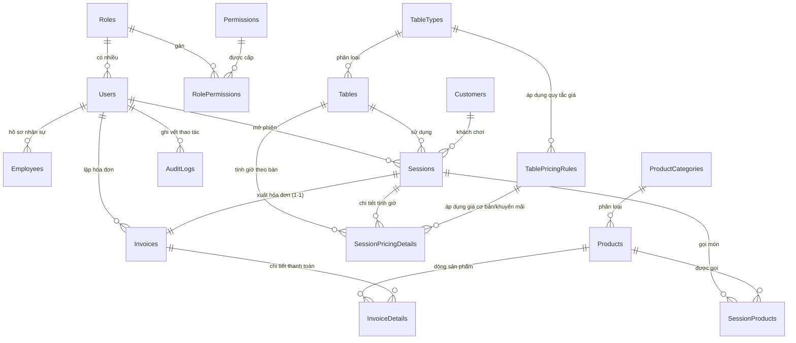

# 🎱 Tài liệu Thiết kế Cơ sở Dữ liệu (Database Documentation)

> **Hệ thống Quản lý Quán Billiard (Billiard Management System)**  
> **Hệ quản trị CSDL:** MySQL 8.0+ (Lưu trữ trên nền tảng Cloud Aiven)  
> **Bộ mã ký tự (Charset / Collation):** `utf8mb4` / `utf8mb4_unicode_ci`  
> **Chế độ bảo mật:** SSL Mode Required  

---

## 📌 I. Sơ đồ Quan hệ Thực thể (Entity Relationship Diagram - ERD)



---

## 📋 II. Chi tiết 17 Bảng trong Cơ sở Dữ liệu

### Nhóm A — Tài khoản và Phân quyền (Authentication & RBAC)

#### 1. `Roles` — Vai trò người dùng
Lưu trữ danh sách vai trò trong hệ thống (chủ quán, nhân viên).

| Trường | Kiểu dữ liệu | Ràng buộc | Mô tả |
| :--- | :--- | :--- | :--- |
| `RoleId` | `INT` | `PK, AUTO_INCREMENT` | Mã định danh vai trò |
| `RoleName` | `VARCHAR(30)` | `NOT NULL, UNIQUE` | Tên vai trò (`Admin`, `Staff`) |
| `Description` | `VARCHAR(255)` | `NULL` | Mô tả chi tiết vai trò |

#### 2. `Users` — Tài khoản đăng nhập
Tài khoản người dùng đăng nhập vào phần mềm. Mật khẩu được băm bằng thuật toán BCrypt.

| Trường | Kiểu dữ liệu | Ràng buộc | Mô tả |
| :--- | :--- | :--- | :--- |
| `UserId` | `BIGINT` | `PK, AUTO_INCREMENT` | Mã tài khoản |
| `RoleId` | `INT` | `FK → Roles.RoleId, NOT NULL` | Vai trò của tài khoản |
| `Username` | `VARCHAR(50)` | `NOT NULL, UNIQUE` | Tên đăng nhập |
| `PasswordHash` | `VARCHAR(255)` | `NOT NULL` | Mật khẩu đã băm bằng BCrypt |
| `FullName` | `VARCHAR(100)` | `NOT NULL` | Họ và tên hiển thị |
| `Phone` | `VARCHAR(20)` | `NULL` | Số điện thoại liên hệ |
| `IsActive` | `BOOLEAN` | `NOT NULL, DEFAULT TRUE` | Trạng thái kích hoạt tài khoản |
| `CreatedAt` | `DATETIME` | `NOT NULL, DEFAULT CURRENT_TIMESTAMP` | Thời điểm tạo tài khoản |

#### 3. `Permissions` — Danh mục quyền hệ thống
Định nghĩa các quyền hạn cụ thể trong phần mềm.

| Trường | Kiểu dữ liệu | Ràng buộc | Mô tả |
| :--- | :--- | :--- | :--- |
| `PermissionId` | `INT` | `PK, AUTO_INCREMENT` | Mã quyền |
| `PermissionCode` | `VARCHAR(50)` | `NOT NULL, UNIQUE` | Mã quyền duy nhất (Code) |
| `PermissionName` | `VARCHAR(100)` | `NOT NULL` | Tên quyền hiển thị |
| `Description` | `VARCHAR(255)` | `NULL` | Mô tả phạm vi quyền |

*Mã quyền mẫu:* `TABLE_VIEW`, `SESSION_OPEN`, `SESSION_CLOSE`, `PRODUCT_MANAGE`, `INVOICE_PAY`, `REPORT_VIEW`, `USER_MANAGE`, `ROLE_MANAGE`.

#### 4. `RolePermissions` — Phân quyền cho vai trò
Bảng quan hệ nhiều - nhiều giữa `Roles` và `Permissions`.

| Trường | Kiểu dữ liệu | Ràng buộc | Mô tả |
| :--- | :--- | :--- | :--- |
| `RoleId` | `INT` | `PK ghép, FK → Roles.RoleId` | Vai trò được cấp quyền |
| `PermissionId` | `INT` | `PK ghép, FK → Permissions.PermissionId` | Quyền được cấp |

---

### Nhóm B — Quản lý Bàn Billiard (Table Management)

#### 5. `TableTypes` — Loại bàn chơi
Phân loại các loại bàn trong quán (Bàn Lỗ/Pool, Bàn Libre/Phăng, Bàn 3 Băng).

| Trường | Kiểu dữ liệu | Ràng buộc | Mô tả |
| :--- | :--- | :--- | :--- |
| `TableTypeId` | `INT` | `PK, AUTO_INCREMENT` | Mã loại bàn |
| `TypeName` | `VARCHAR(50)` | `NOT NULL, UNIQUE` | Tên loại bàn |
| `Description` | `VARCHAR(255)` | `NULL` | Mô tả loại bàn |
| `IsActive` | `BOOLEAN` | `NOT NULL, DEFAULT TRUE` | Trạng thái hoạt động |

#### 6. `Tables` — Bàn chơi
Danh sách các bàn chơi thực tế trong quán.

| Trường | Kiểu dữ liệu | Ràng buộc | Mô tả |
| :--- | :--- | :--- | :--- |
| `TableId` | `INT` | `PK, AUTO_INCREMENT` | Mã bàn chơi |
| `TableTypeId` | `INT` | `FK → TableTypes.TableTypeId, NOT NULL` | Loại bàn |
| `TableNumber` | `VARCHAR(20)` | `NOT NULL, UNIQUE` | Số bàn / Tên bàn (Ví dụ: `P01`, `C02`, `3B01`) |
| `Status` | `VARCHAR(20)` | `NOT NULL, DEFAULT 'Available'` | `Available`, `Occupied`, `Maintenance` |
| `IsActive` | `BOOLEAN` | `NOT NULL, DEFAULT TRUE` | Bàn còn hoạt động kinh doanh không |

---

### Nhóm C — Sản phẩm và Dịch vụ (F&B)

#### 7. `ProductCategories` — Danh mục sản phẩm
Phân loại các mặt hàng kinh doanh (Nước giải khát, Đồ ăn nhanh, Thuốc lá,...).

| Trường | Kiểu dữ liệu | Ràng buộc | Mô tả |
| :--- | :--- | :--- | :--- |
| `CategoryId` | `INT` | `PK, AUTO_INCREMENT` | Mã danh mục |
| `CategoryName` | `VARCHAR(100)` | `NOT NULL, UNIQUE` | Tên danh mục |
| `Description` | `VARCHAR(255)` | `NULL` | Mô tả |
| `IsActive` | `BOOLEAN` | `NOT NULL, DEFAULT TRUE` | Trạng thái sử dụng |

#### 8. `Products` — Sản phẩm kinh doanh
Thông tin sản phẩm F&B phục vụ khách hàng.

| Trường | Kiểu dữ liệu | Ràng buộc | Mô tả |
| :--- | :--- | :--- | :--- |
| `ProductId` | `INT` | `PK, AUTO_INCREMENT` | Mã sản phẩm |
| `CategoryId` | `INT` | `FK → ProductCategories.CategoryId, NOT NULL` | Thuộc danh mục nào |
| `ProductName` | `VARCHAR(150)` | `NOT NULL` | Tên sản phẩm |
| `Unit` | `VARCHAR(30)` | `NOT NULL` | Đơn vị tính (`Lon`, `Chai`, `Gói`, `Tô`) |
| `Price` | `DECIMAL(12,2)` | `NOT NULL` | Giá niêm yết hiện tại |
| `ImageUrl` | `VARCHAR(2048)`| `NULL` | Link ảnh sản phẩm (Cloudinary) |
| `IsActive` | `BOOLEAN` | `NOT NULL, DEFAULT TRUE` | Sản phẩm còn kinh doanh không |

---

### Nhóm D — Phiên chơi và Dịch vụ phát sinh (Sessions & Orders)

#### 9. `Sessions` — Phiên chơi tại bàn
Quản lý thời gian khách mở bàn và sử dụng bàn.

| Trường | Kiểu dữ liệu | Ràng buộc | Mô tả |
| :--- | :--- | :--- | :--- |
| `SessionId` | `BIGINT` | `PK, AUTO_INCREMENT` | Mã phiên chơi |
| `TableId` | `INT` | `FK → Tables.TableId, NOT NULL` | Bàn sử dụng |
| `UserId` | `BIGINT` | `FK → Users.UserId, NOT NULL` | Tài khoản mở bàn |
| `CustomerId` | `BIGINT` | `FK → Customers.CustomerId, NULL` | Khách hàng (NULL nếu khách vãng lai) |
| `StartTime` | `DATETIME` | `NOT NULL` | Thời điểm bắt đầu chơi |
| `EndTime` | `DATETIME` | `NULL` | Thời điểm kết thúc (NULL nếu đang chơi) |
| `Status` | `VARCHAR(20)` | `NOT NULL, DEFAULT 'Active'` | `Active` (Đang chơi), `Completed`, `Cancelled` |
| `TableAmount`| `DECIMAL(12,2)` | `NOT NULL, DEFAULT 0.00` | Tổng tiền bàn tính được |

#### 10. `SessionProducts` — Sản phẩm khách gọi trong phiên
Ghi nhận các mặt hàng đồ ăn, nước uống khách gọi vào bàn.

| Trường | Kiểu dữ liệu | Ràng buộc | Mô tả |
| :--- | :--- | :--- | :--- |
| `SessionProductId` | `BIGINT` | `PK, AUTO_INCREMENT` | Mã dòng gọi món |
| `SessionId` | `BIGINT` | `FK → Sessions.SessionId, NOT NULL` | Thuộc phiên chơi nào |
| `ProductId` | `INT` | `FK → Products.ProductId, NOT NULL` | Sản phẩm được gọi |
| `Quantity` | `INT` | `NOT NULL, CHECK (Quantity > 0)` | Số lượng gọi |
| `UnitPrice` | `DECIMAL(12,2)` | `NOT NULL` | Đơn giá **tại thời điểm gọi** (Snapshot) |
| `Amount` | `DECIMAL(12,2)` | `NOT NULL` | Thành tiền = `Quantity * UnitPrice` |
| `CreatedAt` | `DATETIME` | `NOT NULL, DEFAULT CURRENT_TIMESTAMP` | Thời điểm gọi món |

---

### Nhóm E — Hóa đơn và Thanh toán (Invoices & Billing)

#### 11. `Invoices` — Hóa đơn thanh toán
Hóa đơn tổng kết tiền bàn và tiền dịch vụ để thu tiền khách.

| Trường | Kiểu dữ liệu | Ràng buộc | Mô tả |
| :--- | :--- | :--- | :--- |
| `InvoiceId` | `BIGINT` | `PK, AUTO_INCREMENT` | Mã nội bộ hóa đơn |
| `InvoiceCode` | `VARCHAR(30)` | `NOT NULL, UNIQUE` | Mã hiển thị (Ví dụ: `HD261028-001`) |
| `SessionId` | `BIGINT` | `FK → Sessions.SessionId, NOT NULL, UNIQUE` | Phiên chơi tương ứng (Quan hệ 1-1) |
| `UserId` | `BIGINT` | `FK → Users.UserId, NOT NULL` | Nhân viên lập hóa đơn |
| `CreatedAt` | `DATETIME` | `NOT NULL, DEFAULT CURRENT_TIMESTAMP` | Thời điểm xuất hóa đơn |
| `TableAmount` | `DECIMAL(12,2)` | `NOT NULL, DEFAULT 0.00` | Tổng tiền giờ bàn |
| `ServiceAmount` | `DECIMAL(12,2)` | `NOT NULL, DEFAULT 0.00` | Tổng tiền F&B |
| `DiscountAmount` | `DECIMAL(12,2)` | `NOT NULL, DEFAULT 0.00` | Tiền giảm giá |
| `TotalAmount` | `DECIMAL(12,2)` | `NOT NULL` | Tiền cần thanh toán |
| `Status` | `VARCHAR(20)` | `NOT NULL, DEFAULT 'Pending'` | `Pending`, `Paid`, `Cancelled` |
| `PaymentMethod` | `VARCHAR(20)` | `NULL` | `Cash`, `BankTransfer` |
| `PaidAt` | `DATETIME` | `NULL` | Thời điểm thanh toán thành công |

$$\text{TotalAmount} = \text{TableAmount} + \text{ServiceAmount} - \text{DiscountAmount}$$

#### 12. `InvoiceDetails` — Chi tiết dòng hóa đơn
Lưu trữ đầy đủ các khoản tiền cần in ra phiếu hóa đơn cho khách.

| Trường | Kiểu dữ liệu | Ràng buộc | Mô tả |
| :--- | :--- | :--- | :--- |
| `InvoiceDetailId` | `BIGINT` | `PK, AUTO_INCREMENT` | Mã dòng chi tiết |
| `InvoiceId` | `BIGINT` | `FK → Invoices.InvoiceId, NOT NULL` | Hóa đơn liên kết |
| `ItemType` | `VARCHAR(20)` | `NOT NULL, CHECK IN ('Table', 'Product')`| Loại dòng: Tiền bàn hoặc Sản phẩm |
| `ProductId` | `INT` | `FK → Products.ProductId, NULL` | Sản phẩm (NULL nếu là dòng tiền bàn) |
| `Description` | `VARCHAR(255)`| `NOT NULL` | Nội dung in lên bill (Ví dụ: Tiền bàn P01 (18h-19h)) |
| `Quantity` | `DECIMAL(10,2)`| `NOT NULL` | Số lượng hoặc số giờ chơi |
| `UnitPrice` | `DECIMAL(12,2)`| `NOT NULL` | Đơn giá chụp lại tại lúc xuất bill |
| `Amount` | `DECIMAL(12,2)`| `NOT NULL` | Thành tiền của dòng |

---

### Nhóm F — Quy tắc Giá và Tính Tiền Giờ (Pricing Rules Engine)

#### 13. `TablePricingRules` — Bảng quy tắc giá theo giờ và khuyến mãi
Định cấu hình giá cơ bản và khuyến mãi theo loại bàn, ngày trong tuần hoặc khung giờ.

| Trường | Kiểu dữ liệu | Ràng buộc | Mô tả |
| :--- | :--- | :--- | :--- |
| `PricingRuleId` | `BIGINT` | `PK, AUTO_INCREMENT` | Mã quy tắc |
| `TableTypeId` | `INT` | `FK → TableTypes.TableTypeId, NOT NULL` | Áp dụng cho loại bàn nào |
| `RuleName` | `VARCHAR(100)` | `NOT NULL` | Tên quy tắc (Ví dụ: Giá cuối tuần) |
| `RuleType` | `VARCHAR(20)` | `NOT NULL, CHECK IN ('BaseRate', 'Promotion')` | Loại quy tắc |
| `DayType` | `VARCHAR(20)` | `NOT NULL, CHECK IN ('Weekday', 'Weekend', 'Holiday', 'Any')` | Ngày áp dụng |
| `StartTime` | `TIME` | `NULL` | Giờ bắt đầu áp dụng trong ngày |
| `EndTime` | `TIME` | `NULL` | Giờ kết thúc áp dụng trong ngày |
| `HourlyRate` | `DECIMAL(12,2)` | `NULL` | Giá thuê 1 giờ (dành cho `BaseRate`) |
| `DiscountType` | `VARCHAR(20)` | `NULL, CHECK IN ('Percentage', 'FixedAmount')` | Kiểu giảm giá |
| `DiscountValue`| `DECIMAL(12,2)` | `NULL` | Mức giảm (% hoặc số tiền) |
| `EffectiveFrom`| `DATE` | `NOT NULL` | Ngày bắt đầu hiệu lực |
| `EffectiveTo` | `DATE` | `NULL` | Ngày hết hiệu lực (NULL: vô thời hạn) |
| `Priority` | `INT` | `NOT NULL, DEFAULT 1` | Độ ưu tiên khi có nhiều quy tắc trùng khớp |
| `IsActive` | `BOOLEAN` | `NOT NULL, DEFAULT TRUE` | Trạng thái kích hoạt quy tắc |
| `CreatedAt` | `DATETIME` | `NOT NULL, DEFAULT CURRENT_TIMESTAMP` | Thời điểm tạo |

#### 14. `SessionPricingDetails` — Chi tiết các khoảng thời gian tính tiền
Chia phiên chơi thành từng khoảng thời gian (Time Slice) có mức giá cố định. Hỗ trợ chuyển bàn mượt mà.

| Trường | Kiểu dữ liệu | Ràng buộc | Mô tả |
| :--- | :--- | :--- | :--- |
| `SessionPricingDetailId` | `BIGINT` | `PK, AUTO_INCREMENT` | Mã khoảng tính giá |
| `SessionId` | `BIGINT` | `FK → Sessions.SessionId, NOT NULL` | Phiên chơi |
| `TableId` | `INT` | `FK → Tables.TableId, NOT NULL` | Bàn sử dụng trong khoảng này (Hỗ trợ chuyển bàn) |
| `BasePricingRuleId` | `BIGINT` | `FK → TablePricingRules.PricingRuleId, NOT NULL` | Quy tắc giá cơ bản được áp dụng |
| `PromotionPricingRuleId` | `BIGINT` | `FK → TablePricingRules.PricingRuleId, NULL` | Quy tắc khuyến mãi (nếu có) |
| `StartTime` | `DATETIME` | `NOT NULL` | Bắt đầu khoảng tính giá |
| `EndTime` | `DATETIME` | `NOT NULL` | Kết thúc khoảng tính giá |
| `DurationMinutes` | `DECIMAL(10,2)` | `NOT NULL` | Số phút chơi trong khoảng |
| `BaseHourlyRate` | `DECIMAL(12,2)` | `NOT NULL` | Giá cơ bản chụp lại |
| `DiscountType` | `VARCHAR(20)` | `NULL` | Loại giảm giá |
| `DiscountValue` | `DECIMAL(12,2)` | `NOT NULL, DEFAULT 0.00` | Mức giảm chụp lại |
| `FinalHourlyRate` | `DECIMAL(12,2)` | `NOT NULL` | Giá thực tế 1 giờ sau giảm |
| `Amount` | `DECIMAL(12,2)` | `NOT NULL` | Tiền bàn trong khoảng = `(DurationMinutes / 60) * FinalHourlyRate` |

---

### Nhóm G — Khách hàng và Nhân viên (Customers & Employees)

#### 15. `Customers` — Khách hàng
Quản lý khách quen đến quán chơi bida.

| Trường | Kiểu dữ liệu | Ràng buộc | Mô tả |
| :--- | :--- | :--- | :--- |
| `CustomerId` | `BIGINT` | `PK, AUTO_INCREMENT` | Mã khách hàng |
| `FullName` | `VARCHAR(100)` | `NOT NULL` | Tên khách hàng |
| `Phone` | `VARCHAR(20)` | `NULL, INDEX` | Số điện thoại liên hệ |
| `CreatedAt` | `DATETIME` | `NOT NULL, DEFAULT CURRENT_TIMESTAMP` | Ngày tạo hồ sơ |
| `IsActive` | `BOOLEAN` | `NOT NULL, DEFAULT TRUE` | Trạng thái hoạt động |

#### 16. `Employees` — Hồ sơ nhân sự
Lưu thông tin nhân sự riêng biệt với tài khoản đăng nhập.

| Trường | Kiểu dữ liệu | Ràng buộc | Mô tả |
| :--- | :--- | :--- | :--- |
| `EmployeeId` | `BIGINT` | `PK, AUTO_INCREMENT` | Mã nhân viên |
| `UserId` | `BIGINT` | `FK → Users.UserId, NOT NULL, UNIQUE` | Tài khoản tương ứng (1-1) |
| `Email` | `VARCHAR(100)` | `NULL` | Email nhân viên |
| `Address` | `VARCHAR(255)` | `NULL` | Địa chỉ liên lạc |
| `HireDate` | `DATE` | `NULL` | Ngày vào làm việc |
| `Position` | `VARCHAR(50)` | `NULL` | Vị trí công việc (Thu ngân, Phục vụ,...) |
| `IsActive` | `BOOLEAN` | `NOT NULL, DEFAULT TRUE` | Trạng thái làm việc |

---

### Nhóm H — Nhật ký Thao tác (Audit Trail)

#### 17. `AuditLogs` — Nhật ký kiểm toán thao tác hệ thống
Truy vết mọi thao tác nhạy cảm (mở bàn, đổi giá, xóa sản phẩm, sửa phân quyền).

| Trường | Kiểu dữ liệu | Ràng buộc | Mô tả |
| :--- | :--- | :--- | :--- |
| `AuditLogId` | `BIGINT` | `PK, AUTO_INCREMENT` | Mã nhật ký |
| `UserId` | `BIGINT` | `FK → Users.UserId, NULL` | Tài khoản thực hiện (NULL nếu do hệ thống) |
| `Action` | `VARCHAR(50)` | `NOT NULL, INDEX` | Hành động (`OPEN_SESSION`, `PAY_INVOICE`,...) |
| `EntityType` | `VARCHAR(50)` | `NOT NULL` | Loại thực thể (`Session`, `Invoice`, `PricingRule`) |
| `EntityId` | `BIGINT` | `NULL` | ID của bản ghi bị tác động |
| `Description` | `VARCHAR(500)` | `NULL` | Diễn giải chi tiết |
| `OldValues` | `JSON` | `NULL` | Giá trị trước khi sửa (Snapshot JSON) |
| `NewValues` | `JSON` | `NULL` | Giá trị sau khi sửa (Snapshot JSON) |
| `CreatedAt` | `DATETIME` | `NOT NULL, DEFAULT CURRENT_TIMESTAMP, INDEX` | Thời điểm ghi log |

---

## 🔐 III. Thông tin Dữ liệu Mẫu (Seed Data)

### 1. Tài khoản đăng nhập mặc định:
- **Admin (Chủ quán):**
  - Username: `admin`
  - Mật khẩu: `Admin@123`
  - Quyền hạn: Toàn quyền quản trị và xem báo cáo.
- **Staff (Nhân viên ca 1):**
  - Username: `staff01`
  - Mật khẩu: `Admin@123`
  - Quyền hạn: Quản lý bàn, gọi món và thanh toán hóa đơn.

### 2. Danh sách bàn mẫu:
- Bàn Pool (Lỗ): `P01`, `P02`, `P03` (Giá ngày thường: 50.000đ/h, cuối tuần: 70.000đ/h).
- Bàn Carom (Libre): `C01`, `C02` (Giá ngày thường: 45.000đ/h, cuối tuần: 60.000đ/h).
- Bàn 3 Băng: `3B01` (Giá cố định: 80.000đ/h).

---

## ⚙️ IV. Cấu hình Kết nối trong Dự án .NET / C#

### Cơ chế bảo mật chuỗi kết nối (`connections.config`):
Theo chuẩn của các ứng dụng WPF/.NET chuyên nghiệp, chuỗi kết nối nhạy cảm được tách riêng ra file `connections.config` (được đưa vào `.gitignore` để không bị lộ lên Git). File `App.config` chỉ tham chiếu thông qua thuộc tính `configSource`:

**File `App.config`:**
```xml
<configuration>
    <connectionStrings configSource="connections.config" />
</configuration>
```

**File `connections.config` (nội bộ máy phát triển / máy thu ngân):**
```xml
<connectionStrings>
    <add name="BilliardDb" 
         connectionString="Server=YOUR_HOST;Port=YOUR_PORT;Database=defaultdb;User ID=YOUR_USER;Password=YOUR_PASSWORD;SslMode=Required;CharSet=utf8mb4;" 
         providerName="MySqlConnector" />
</connectionStrings>
```

### Sử dụng lớp `DatabaseHelper` trong mã nguồn C#:
```csharp
// Kiểm tra kết nối nhanh chóng:
var testResult = await DatabaseHelper.TestConnectionAsync();
if (testResult.Success) 
{
    // Kết nối thành công, bắt đầu tải dữ liệu
}

// Mở kết nối và thực thi truy vấn:
using (var conn = await DatabaseHelper.OpenConnectionAsync())
{
    using (var cmd = new MySqlCommand("SELECT TableNumber, Status FROM Tables WHERE IsActive = TRUE;", conn))
    {
        using (var reader = await cmd.ExecuteReaderAsync())
        {
            while (await reader.ReadAsync())
            {
                string tableNumber = reader.GetString(0);
                string status = reader.GetString(1);
            }
        }
    }
}
```
